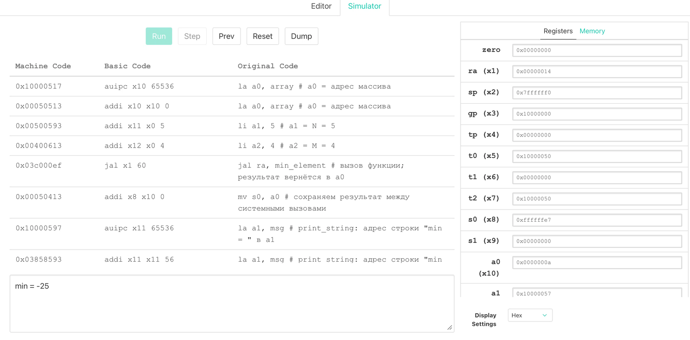

# Лабораторная работа 1

## 1. Цель

Получить общее представление о системе команд RISC-V путём решения несложной прикладной задачи — обработки двумерного массива.

## 2. Задание

1. Создать аккаунт на github(если еще нет) и создать репозиторий с именем lab-riscv-asm.
2. Разработать алгоритм решения вашего варианта задачи.
3. Реализовать алгоритм на языке ассемблера RISCV ISA. Исходный код
программы сохранить в репозитории.
4. Реализовать алгоритм на языке Си. Исходный код программы сохранить
в репозитории.
5. Скомпилировать Си-код используя riscv-компилятор. Получить дампфайл из скомпилированного исполняемого файла вашей программы. Сохранить дамп-файл в репозитории.
6. Оформить отчет о проделанной работе и результатах в виде README.md файла вашего репозитоия.
7. Продемонстрировать результаты работы в симуляторе Venus https://www.kvakil.me/venus/


## 3. Вариант задания

**Вариант 1:** найти значение минимального элемента двумерного массива.
Размер массива: **N = 5** (строк), **M = 4** (столбца), всего 20 элементов.

Массив:

| Стобец 0 | Столбец 1 | Столбец 2 | Столбец 3 |
|----------|-----------|-----------|-----------|
|3         |-7         |12         |5          |
|0         |9          |-2         |44         |
|18        |-25        |6          |7          |
|11        |4          |13         |-25        |
|-1        |8          |2          |30         |


Ожидаемый результат: min = −25.

## 4. Алгоритм

Задача решается линейным просмотром всех `N * M` элементов:

```
функция min_element(a, n, m):
    min <- a[0]                    # первый элемент - начальное значение
    для i от 0 до n-1:
        для j от 0 до m-1:
            value <- a[i * m + j]  # адрес = base + (i * m + j) * 4
            если value < min:
                min <- value
    вернуть min
```

* Сложность - `O(N·M)`, для N = 5, M = 4 это 20 сравнений.


## 5. Реализация на языке ассемблера RISCV ISA

Файл: [`src/min_element.s`](src/min_element.s)

В RISC-V вызов и передача аргументов выполняются по соглашениям о вызовах (ABI):

| Регистр | ABI | Использование в программе |
|---------|-------------|---------------------------|
| `a0` | аргумент 1 / возвращаемое значение | адрес массива; после возврата - минимум |
| `a1` | аргумент 2 | количество строк `n` |
| `a2` | аргумент 3 | количество столбцов `m` |
| `ra` | адрес возврата | заполняется `jal`, сохраняется в стеке функцией |
| `s0`-`s2` | callee-saved | `s0` - текущий минимум, `s1` - счётчик строк, `s2` - `m` |
| `t0`-`t4` | caller-saved | указатели и счётчики циклов |
| `sp` | указатель стека | пролог и эпилог функции |

Ключевые фрагменты:

```asm
main:
        la      a0, array          # a0 = адрес массива
        li      a1, 5              # a1 = N = 5
        li      a2, 4              # a2 = M = 4
        jal     ra, min_element    # вызов функции; результат вернётся в a0
```

```asm
min_element:
        addi    sp, sp, -16        # пролог: сохраняем ra и s-регистры
        sw      ra, 12(sp)
        sw      s0, 8(sp)
        sw      s1, 4(sp)
        sw      s2, 0(sp)

        lw      s0, 0(a0)          # min = a[0][0]
        mv      s1, a1             # s1 = n
        mv      s2, a2             # s2 = m
        mv      t0, a0             # t0 = адрес начала строки

row_loop:
        beqz    s1, done
        mv      t1, s2             # t1 = m
        mv      t2, t0             # t2 = адрес текущего элемента
col_loop:
        beqz    t1, next_row
        lw      t3, 0(t2)          # t3 = a[i][j]
        bge     t3, s0, skip       # a[i][j] >= min -> минимум не меняется
        mv      s0, t3             # иначе новый минимум
skip:
        addi    t2, t2, 4          # следующий элемент (int = 4 байта)
        addi    t1, t1, -1
        j       col_loop
next_row:
        slli    t4, s2, 2          # t4 = m * 4 - длина строки в байтах
        add     t0, t0, t4         # переход к следующей строке
        addi    s1, s1, -1
        j       row_loop
done:
        mv      a0, s0             # возвращаемое значение - минимум
        lw      ra, 12(sp)         # эпилог
        lw      s0, 8(sp)
        lw      s1, 4(sp)
        lw      s2, 0(sp)
        addi    sp, sp, 16
        ret
```

Особенности реализации:

* внутренний цикл идёт по указателю (`lw t3, 0(t2)`), поэтому умножение
  внутри цикла не нужно вообще;
* смещение строки считается сдвигом `slli t4, s2, 2` (умножение на 4);
* функция сохраняет и восстанавливает `ra` и используемые `s`-регистры,
  как требует ABI;
* результат возвращается в `a0`; вывод выполняется в `main` системными вызовами
  Venus: `ecall` 4 (`print_string`, адрес строки в `a1`), `ecall` 1
  (`print_int`, число в `a1`), `ecall` 10 (`exit`). Номер системного вызова
  в Venus передаётся в `a0` (у аргументов - `a1`–`a7`).

## 6. Реализация на языке Си

Файл: [`src/main.c`](src/main.c).

```c
int min_element(const int *a, int n, int m)
{
    int min = a[0];

    for (int i = 0; i < n; ++i) {
        for (int j = 0; j < m; ++j) {
            int value = a[i * m + j];
            if (value < min) {
                min = value;
            }
        }
    }

    return min;
}

int main(void)
{
    int result = min_element(&array[0][0], N, M);

    printf("min = %d\n", result);

    return 0;
}
```

Си-версия повторяет алгоритм ассемблерной: тот же массив, та же сигнатура
функции, тот же обход, а результат печатается функцией `printf`.

## 7. Компиляция и получение дампа

Компиляция выполняется тулчейном `riscv-gnu-toolchain`, собранным из исходников.
Тулчейн собран как multilib: основной вариант - `rv64gc`/`lp64d`, а нужный в работе
`-march=rv32i -mabi=ilp32` берётся из дополнительного варианта библиотек.

```console
$ riscv64-unknown-elf-gcc -march=rv32i -mabi=ilp32 -O0 src/main.c -o build/lab1.elf
$ riscv64-unknown-elf-objdump -D build/lab1.elf > build/lab1.dump
```

Пояснения:

* `-march=rv32i -mabi=ilp32` - 32-битный базовый набор команд без умножения;
* имя компилятора `riscv64-unknown-elf-gcc`;
* `-lgcc` подключается автоматически: в RV32I нет команды умножения, поэтому
  выражение `i * m` компилятор реализует вызовом `__mulsi3`. В ассемблерной версии этого вызова нет, так как
  смещение строки считается сдвигом.

Результат:

```console
$ file build/lab1.elf
build/lab1.elf: ELF 32-bit LSB executable, UCB RISC-V, soft-float ABI,
version 1 (SYSV), statically linked, with debug_info, not stripped

$ riscv64-unknown-elf-nm build/lab1.elf | grep -E " (main|min_element|printf)$"
000101c4 T min_element
00010288 T main
00010764 T printf
```

Все команды сборки собраны в [`Makefile`](Makefile):

```console
$ make all      # elf + dump: скомпилировать Си-версию и получить дамп
$ make elf      # только скомпилировать Си-версию
$ make dump     # только получить дамп-файл
$ make host     # запустить Си-версию на хост-машине
$ make clean    # удалить каталог build/
```

## 8. Демонстрация работы в симуляторе Venus

На скриншоте ниже - работа программы в Venus: в панели **Console** выведено
`min = -25`, а в панели **Registers** видно, что в `s0` после вызова функции
находится `0xffffffe7` (это −25 в дополнительном коде), а в `a0` - `0xa`
(номер системного вызова `exit`):



На панели **Basic Code** видно, как Venus разворачивает псевдоинструкции:
`la a0, array` превращается в `auipc` + `addi`, `jal ra, min_element` - в
`jal x1 60`. Окно Console после нажатия **Run** показывает результат, а после
`ecall 10` программа завершается.

## 9. Выводы

* Обе реализации - ассемблерная и Си - дают одинаковый: −25. Ассемблерная программа
  продемонстрирована в симуляторе Venus, результат в Console совпадает с результатом Си-версии.
* В RISC-V вызов функции выполняется по соглашениям ABI: аргументы передаются
  в `a0`–`a2`, результат возвращается в `a0`, `ra` и `s`-регистры сохраняются
  вызываемой функцией на стеке.
* При обработке массива указателем (`lw t3, 0(t2)`) и сдвиге для вычисления
  длины строки (`slli`) программа не выходит за пределы базового RV32I и не
  требует библиотечной реализации умножения, тогда как скомпилированный с
  `-O0` Си-код вызывает `__mulsi3` из libgcc.
* Си-компилятор при `-O0` генерирует заметно больше кода, но семантически эквивалентен ручному
  ассемблеру. Подключение `printf` тянет за собой значительную часть newlib:
  исполняемый файл занимает 232 КБ, а дамп - около 3,6 МБ.
